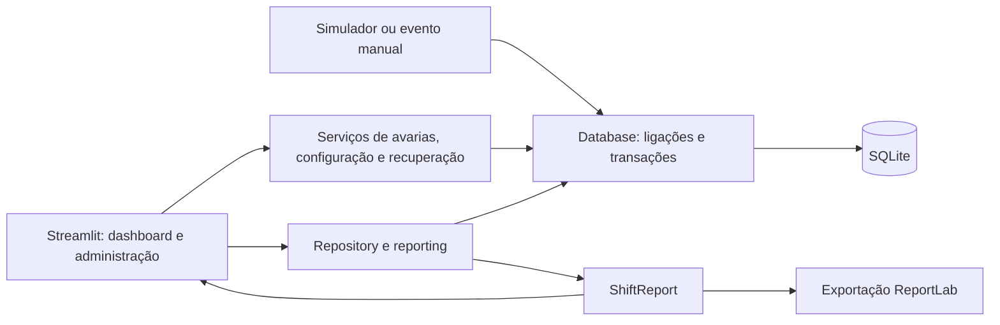
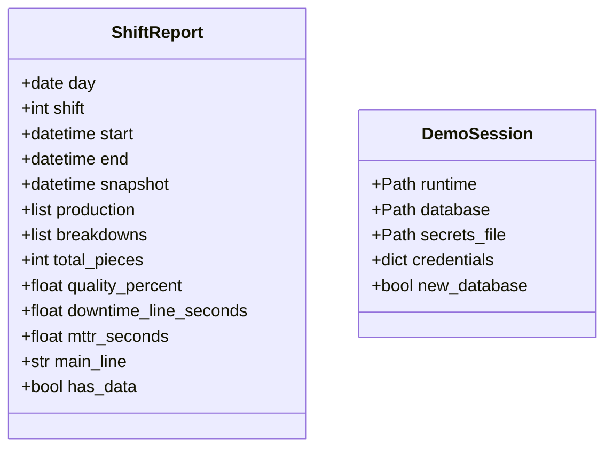

# Relatório Técnico — BRUNUS MES

**Projeto:** BRUNUS MES — Manufacturing Execution System

**Autor:** Bruno Abreu

**Modalidade:** Opção B — Projeto livre, UFCD/UC 5425.

**Revisão:** 2 de novembro de 2026

**Referência:** [issue #1 — consolidar dados, relatórios e testes](https://github.com/BrunoAbreu96/Projeto_Final/issues/1)

## 1. Objetivo e âmbito

O BRUNUS MES é uma aplicação de formação para acompanhar produção, qualidade e avarias. A demonstração começa com duas linhas e oito estações. Esta revisão inclui relatórios por data, turno e linha, alterações de estado transacionais, configuração, backup/restauro e testes independentes da base industrial original.

A monitorização mostra o estado atual; indicadores e PDF mostram o período selecionado. Os dados são de demonstração. Não existe ligação a PLC real nem cálculo completo de OEE.

### 1.1. Cenário e fronteiras

A célula de demonstração começa com Main A e Main B, cada uma com quatro estações: alimentação do frame, montagem/aparafusamento PCB, união ótica da lente e teste de fim de linha. Cada registo em `historico_producao` representa **uma peça na saída final da linha**, com resultado OK ou REJEITADA e tempo de ciclo em segundos. Não representa uma passagem por cada estação nem um resumo de várias peças. Os tempos de ciclo são gerados pelo simulador; não são medições de um PLC.

Cada avaria referencia uma estação e contém diagnóstico, início e eventual fim. No simulador, qualquer avaria ativa suspende a produção da respetiva linha. O utilizador consulta os registos e um técnico/master valida a resolução. O fluxo completo é geração, gravação SQLite, consulta no dashboard e exportação PDF do período escolhido.

O operador consulta; o técnico também resolve avarias; o master administra configuração, cópias e dados de demonstração. A primeira versão é local, com dados sintéticos e credenciais externalizadas. Aquisição OPC UA, operação multiutilizador industrial, OEE completo e subscrição comercial pertencem a uma evolução posterior.

### 1.2. Engenharia de requisitos

Os requisitos foram levantados a partir da proposta aprovada, das observações do formador, da issue #1 e da utilização da aplicação de demonstração. As necessidades foram convertidas em operações verificáveis e associadas a testes. A modalidade B permite uma interface simples; a prioridade desta versão é a coerência entre domínio, regras, persistência e resultados.

| Requisito funcional | Comportamento implementado | Evidência |
|---|---|---|
| RF01 — Acesso por perfil | Autenticar, terminar sessão e limitar ações por operador/técnico/master | `auth.py`, serviços e testes de interface/permissões |
| RF02 — Monitorização | Consultar estações e avarias ativas de todas as linhas configuradas | `repository.py`, dashboard e testes de interface |
| RF03 — Produção simulada | Gerar uma peça OK/rejeitada ou avaria; impedir produção numa linha parada | Simulador, `demo.py` e testes do fluxo de aceitação |
| RF04 — Manutenção | Resolver apenas avarias ativas, preservando outras ocorrências e histórico | `services.py`, testes de múltiplas avarias e rollback |
| RF05 — Consulta temporal | Filtrar produção e paragens por data de início, turno e linha | `reporting.py`, testes de fronteiras, meia-noite e filtros |
| RF06 — Indicadores e PDF | Calcular FTT, ocorrências, paragens e MTTR com unidades explícitas; exportar o mesmo relatório | `ShiftReport`, `pdf_report.py` e testes de relatórios |
| RF07 — Configuração | Adicionar/editar/remover estações, com proteção de identidades que têm histórico | `configuration.py`, testes de validação e integridade |
| RF08 — Recuperação | Criar/descarregar cópia e restaurar após confirmação, guardando o estado anterior | `backups.py`, testes de recuperação e falha transacional |
| RF09 — Operações de demonstração | Encerrar apenas ativas ou limpar dados mediante confirmação e master | `services.py` e testes de autorização/limpeza |

| Requisito não funcional | Critério de verificação e limite |
|---|---|
| RNF01 — Integridade | FK, campos/estados/datas válidos e transações; testes recusam dados inválidos e verificam rollback |
| RNF02 — Organização | Interface, cálculos/regras e persistência em módulos distintos; regras testáveis sem navegador |
| RNF03 — Configuração sensível | Hashes em ficheiro local excluído do Git; base selecionável por `BRUNUS_DB_PATH` |
| RNF04 — Instalação reproduzível | Python mínimo e dependências fixadas, SQL único e comandos no README; evidência da instalação verificada na secção 7 |
| RNF05 — Utilização | Mensagens de erro, filtros e separadores persistentes, unidades e natureza simulada visíveis; AppTest e conferência no navegador |
| RNF06 — Testabilidade | Bases sintéticas temporárias, relógio/caminhos fornecidos aos testes e independência dos dados industriais privados |

Não se assume um nível de disponibilidade, carga ou certificação industrial a partir destes critérios locais. A validação de cada revisão é identificada nas secções 7 e 12.

### 1.3. Aplicação de base e evolução realizada

| Área | Disponível no protótipo de base | Evolução desenvolvida e documentada |
|---|---|---|
| Interface e simulação | Streamlit, cartões das duas linhas e geração sintética de produção/avarias | Organização dos módulos, monitorização clara, comandos finitos e modo manual por linha |
| Perfis | Identificação por perfis e controlos na aplicação inicial | Hashes externalizados, sessão Streamlit isolada e permissões também nos serviços |
| SQLite | Tabelas e histórico local | Esquema único, FK/CHECK, caminho configurável, transações e migração explícita com backup |
| Indicadores e PDF | Gráficos, totais, estimativas e exportação | Filtros efetivos de data/turno/linha, definição FTT, sobreposições e PDF a partir do mesmo modelo |
| Resolução e reset | Ações sobre avarias e dados | Resolução só de ativas, estado coerente com outras avarias, preservação das datas e confirmação de limpeza |
| Administração e distribuição local | Configuração inicial fixa | Formulários de estações, backup/restauro e lançador de demonstração isolado |
| Qualidade e documentação | Proposta e código inicial | Testes sintéticos/aceitação/interface, README reprodutível e modelo/decisões alinhados com a implementação |

Esta tabela descreve a evolução do projeto ao longo das revisões. As secções 10 a 12 e o histórico Git distinguem as atividades por aula; não se atribui todo o desenvolvimento à última revisão.

## 2. Tecnologias e arquitetura

SQLite permite demonstrar uma base relacional sem instalar um servidor. Para vários utilizadores e disponibilidade industrial, será necessário avaliar concorrência, infraestrutura e eventual migração para um servidor de base de dados.

Ambiente verificado: Windows, Python **3.14.7**. A versão mínima documentada é **3.11**, de acordo com as dependências. `requirements.txt` fixa as versões diretas verificadas de Streamlit, Pandas, ReportLab, streamlit-autorefresh, asyncua e pytest. A biblioteca asyncua não está integrada numa aquisição real.

| Componente | Responsabilidade |
|---|---|
| `dashboard.py` | Formulários, sessão e apresentação |
| `brunus_mes/auth.py` | Verificação PBKDF2-SHA256 |
| `brunus_mes/database.py` | Caminho configurável, ligações, esquema e migração |
| `brunus_mes/repository.py` | Consultas de estações e avarias ativas |
| `brunus_mes/services.py` | Autorização e operações transacionais |
| `brunus_mes/configuration.py` | Configuração de estações e proteção do histórico |
| `brunus_mes/backups.py` | Cópias SQLite consistentes e restauro atómico |
| `brunus_mes/demo.py` / `ui_admin.py` | Eventos manuais e formulários de administração |
| `brunus_mes/reporting.py` | Seleção temporal, métricas e modelo do relatório |
| `brunus_mes/pdf_report.py` | PDF sem novas consultas à base |
| `simulador_continuo.py` | Eventos sintéticos |
| `iniciar_demo.py` / `iniciar_demo.bat` | Arranque com base e credenciais sintéticas isoladas |
| `sql/criar_base_dados.sql` | Definição única do esquema |

As regras de negócio podem ser testadas sem iniciar Streamlit. A interface e o PDF recebem o mesmo modelo de relatório, evitando cálculos divergentes.

### 2.1. Desenho arquitetural



A apresentação trata widgets e mensagens; os serviços validam ações e permissões; a persistência controla ligações, esquema e transações. O lançador prepara o contexto da demonstração e inicia os processos. O PDF recebe um objeto já calculado e não abre uma segunda consulta à base.

### 2.2. Desenho orientado a objetos

O desenho combina módulos de funções com objetos de dados definidos por `@dataclass`. As classes centrais existentes são `ShiftReport`, que reúne o resultado de uma consulta, e `DemoSession`, que descreve os ficheiros e acessos sintéticos de uma sessão local. Não há classes de serviço ou entidades ORM nesta versão; as estações e eventos lidos por SQL são representados por linhas/dicionários.



O diagrama resume os atributos principais. Qualidade e MTTR podem ser `None` quando não existe amostra; `main_line=None` representa todas as linhas. `has_data` é uma propriedade calculada a partir dos eventos, não um campo persistido. `build_shift_report` cria e preenche `ShiftReport`; interface e PDF recebem esse mesmo objeto. `prepare_demo` devolve `DemoSession`, usada para preparar os comandos e o ambiente dos subprocessos. As classes não dependem uma da outra.

As exceções específicas `MigrationRequired`/`MigrationError` derivam de `RuntimeError`; `BackupError` deriva de `ValueError`. Permitem distinguir situações que exigem migração ou recuperação recusada e apresentar mensagens controladas. A opção por funções para as operações e objetos para os resultados mantém o fluxo explícito e permite fornecer uma base/relógio de teste.

## 3. Modelo e integridade

| Tabela | Significado |
|---|---|
| `cabines` | Linha, estação, processo e estado atual |
| `historico_producao` | Saída final de linha: instante, estado da peça e ciclo |
| `registo_avarias` | Ocorrência associada a cabine, diagnóstico e intervalo |
| `sessao_ativa` | Estrutura histórica preservada; a autenticação usa a sessão Streamlit |

Um registo de produção representa o evento final de linha. Não foi acrescentada uma associação artificial a cabine, pois o simulador não regista cada passagem da peça pelas estações.

O [modelo de dados atual](docs/MODELO_DADOS.md) apresenta o diagrama das tabelas, a chave estrangeira efetiva e a associação lógica por linha, alinhados com esta implementação.

O esquema declara a chave estrangeira `registo_avarias.cabine_id → cabines.id`, campos obrigatórios e restrições de estados, datas e tempos de ciclo. Uma avaria ativa não tem fim; uma resolvida exige fim válido não anterior ao início. Cada ligação de persistência ativa `PRAGMA foreign_keys = ON`, define espera por bloqueio e é fechada após a operação.

O simulador usa a inicialização comum em vez de repetir o esquema. O caminho predefinido `data/brunus_dev.db` é ancorado à pasta do projeto. `BRUNUS_DB_PATH` e `--db` permitem bases separadas.

**Precisão do tipo `REAL`:** SQLite utiliza valores de vírgula flutuante binária para este tipo. Nem todos os decimais têm representação exata; por exemplo, a soma de `0.1` e `0.2` em Python não é exatamente `0.3`. O tipo é usado para tempos de ciclo em segundos, com validação de valores positivos e finitos. A apresentação arredondada não torna o armazenamento exato. Valores financeiros nesta aplicação são estimativas fictícias; uma contabilização real exigiria uma política explícita de precisão e arredondamento, usando, por exemplo, unidades monetárias inteiras ou decimal adequado. Esta descrição corrige a afirmação de exatidão do modelo preliminar.

## 4. Migração e preservação do histórico

Uma base antiga não é modificada automaticamente ao abrir a aplicação. É necessária migração explícita:

```powershell
.\.venv\Scripts\python.exe -m brunus_mes.database migrate --db .\data\brunus_revisao.db
```

O procedimento recomendado é parar os processos e testar numa cópia, conservando a origem. A migração valida os dados em memória, guarda um backup SQLite consistente e reconstrói as tabelas numa transação. Preserva IDs, histórico e sequências de numeração; converte `RESOLVED` para `RESOLVIDO` e recalcula os estados atuais das cabines pelas avarias ativas. Uma base atualizada não volta a ser migrada.

Referências inválidas, dados incompatíveis ou estruturas adicionais não suportadas fazem abortar a operação, incluindo extensões de esquema cuja conservação automática não é garantida. Não se elimina histórico para satisfazer restrições. A correção requer análise numa cópia e uma decisão documentada. A validação preliminar pode falhar antes do backup automático; este não substitui a conservação da origem.

As bases industriais locais não foram utilizadas nos testes normais nem migradas como parte da validação automatizada.

## 5. Avarias, transações e perfis

A resolução usa uma transação com reserva de escrita para identificar a ocorrência ativa, guardar o fim e atualizar a cabine. Se houver outras ocorrências ativas nessa cabine, esta permanece em `ERRO`. Uma ocorrência resolvida não recebe novo fim. Qualquer falha desfaz a operação completa.

O encerramento global afeta apenas ocorrências ativas. A limpeza está identificada como demonstração, exige confirmação explícita e elimina produção e avarias na mesma transação que repõe as estações.

| Perfil | Consulta e PDF | Resolução | Encerramento e limpeza |
|---|---|---|---|
| Operador | Permitidos | Recusada | Recusados |
| Técnico | Permitidos | Permitida | Recusados |
| Master | Permitidos | Permitida | Permitidos |

As permissões são verificadas nos serviços. A autenticação conserva hashes PBKDF2-HMAC-SHA256 e comparação segura; rejeita configuração inválida. Credenciais permanecem fora do código e do Git. O gerador cria `.streamlit` numa instalação nova.

## 6. Turnos, indicadores e PDF

A data selecionada é a data civil de início do turno. O início pertence ao intervalo e o fim é exclusivo:

| Turno | Intervalo |
|---|---|
| 1 | 08:00–17:00 do próprio dia |
| 2 | 17:00 do próprio dia–01:00 do dia seguinte |
| 3 | 01:00–08:00 do próprio dia |

A produção é filtrada pelo intervalo e pela consulta. As duas consultas do relatório usam uma transação de leitura consistente.

**Ocorrências** contam pelo início da avaria. **Paragem** inclui avarias anteriores que coincidem com o turno, recortando cada intervalo. Uma avaria aberta conta até à consulta ou ao fim do turno. Intervalos sobrepostos da mesma linha são unidos; a soma entre linhas tem unidade **segundos-linha**. Não representa indisponibilidade física da célula.

**MTTR** é a média da duração completa das avarias iniciadas no turno e concluídas até à consulta. Pode incluir reparação posterior ao fim do turno. A interface e o PDF explicitam essa coorte.

**Qualidade FTT** é `OK / total × 100`. Sem produção, não há percentagem. O OEE completo exigiria também disponibilidade e desempenho com dados e definições adicionais.

As estimativas financeiras usam margem fictícia de 100 EUR/peça OK, custo de 35 EUR/peça rejeitada e 150 EUR/minuto-linha parado:

`resultado estimado = OK × 100 − rejeitadas × 35 − segundos-linha / 60 × 150`

Os parâmetros e a natureza simulada constam da interface e PDF. Não são lucro efetivamente apurado. O documento identifica data, turno, limites, consulta, totais e critérios. Sem dados, a interface mostra uma mensagem em vez de exportar histórico global como relatório de turno.

## 7. Testes efetivamente executados em 30/10/2026

As validações usam bases temporárias e dados sintéticos. A mesma suite foi executada no ambiente do projeto e numa instalação nova; as duas execuções não são somadas como testes distintos.

| Validação | Resultado registado |
|---|---|
| Suite completa no ambiente do projeto | 109 aprovados, 1 teste privado ignorado, 4 avisos; 6,85 s |
| Mesma suite numa instalação nova | 109 aprovados, 1 teste privado ignorado, 4 avisos; 8,63 s |
| Interação Streamlit com AppTest | 5 aprovados, incluídos na suite completa |
| Autenticação | 25 aprovados, incluídos na suite completa |
| Instalação nova, Python 3.14.7, sem base original nem credenciais locais | Dependências de `requirements.txt` instaladas |
| `pip check` no ambiente novo | Sem incompatibilidades reportadas |
| Inicialização e simulação na cópia nova | 8 estações e 3 peças OK |
| Servidor Streamlit na instalação nova | Saúde HTTP 200 e página HTTP 200 |
| Compilação dos módulos Python com `compileall` | Concluída sem erros |
| PDF de demonstração, renderização e inspeção visual | Uma página; conteúdo e disposição verificados |

Os quatro avisos são `Pandas4Warning`, emitidos por uma rotina de gráficos do Streamlit que utiliza `reset_index(inplace=True)`. Indicam compatibilidade futura numa dependência; não houve falhas na suite.

O teste de aceitação prepara uma base nova, insere produção e avaria, verifica que uma linha parada não produz, recusa resolução por operador, resolve com técnico e confirma estado e duração de 300 segundos. Compara depois o relatório com a base: uma peça OK, uma ocorrência, MTTR de 300 segundos, 300 segundos-linha e custo fictício de 750 EUR. Por fim gera o PDF.

Foi ainda gerado, renderizado e inspecionado um PDF do turno 2 de 29/10/2026, entre as 17:00 e a 01:00 de 30/10, consultado às 08:00 de 30/10. Os dados sintéticos produziram 3 peças, 2 OK e 1 rejeitada, qualidade de 66,67%, 900 segundos-linha de paragem (600 na Main A e 300 na Main B), MTTR de 420 segundos e resultado estimado de −2 085 EUR. O documento final ocupa uma página.

A suite cobre ainda referências inválidas, campos e estados inválidos, migração com conservação de IDs, abortar migração inválida, rollback, várias avarias na mesma cabine, preservação de datas, confirmação de limpeza, turnos com meia-noite, limites temporais, sobreposições, avarias abertas, períodos vazios e hashes inválidos.

No ambiente isolado Windows, a pasta temporária padrão do pytest causou um erro de permissões antes do teste de aceitação. Uma pasta descartável dentro do projeto permite configurar esse armazenamento. A instalação e arranque foram também verificados fora desse isolamento. Erros de infraestrutura não foram registados como testes funcionais aprovados.

Para reproduzir:

```powershell
New-Item -ItemType Directory -Force -Path .\tmp | Out-Null
.\.venv\Scripts\python.exe -m pytest .\tests -q --basetemp .\tmp\pytest
```

O teste privado da base original só é ativado por `BRUNUS_ORIGINAL_DB`, abre em modo de leitura e é ignorado por defeito. A entrega não depende de dados industriais privados.

## 8. Instalação e critérios da issue

O README documenta ambiente virtual, dependências, criação de `data`, esquema, estações sintéticas, credenciais, simulador, dashboard, caminho configurável e migração. A instalação foi exercitada numa cópia apenas com os ficheiros publicáveis, sem `.venv`, credenciais, base original ou dados locais.

| Pedido | Implementação e evidência |
|---|---|
| Relatórios por data e turno | `reporting.py`, `pdf_report.py`, testes de limites e interseções |
| Integridade e esquema único | SQL, `database.py`, testes de esquema e migração |
| Resolução consistente | Serviços e testes de atomicidade e avarias simultâneas |
| Resets que preservam histórico encerrado | Autorização, confirmação e rollback |
| Indicadores e estimativas claros | FTT, segundos-linha e fórmulas documentados |
| Separação de responsabilidades | Package `brunus_mes` e apresentação Streamlit |
| Testes reproduzíveis | Dados sintéticos e fluxo de aceitação |
| Instalação e apresentação | Cópia nova verificada, textos UTF-8 e documentação |

### 8.1. Manual de instalação e execução

Requisitos: Python 3.11 ou superior, Git para obter o código e as dependências de `requirements.txt`. No Windows, abrir PowerShell e executar:

```powershell
git clone https://github.com/BrunoAbreu96/Projeto_Final.git
cd Projeto_Final
python -m venv .venv
.\.venv\Scripts\python.exe -m pip install -r requirements.txt
.\iniciar_demo.bat
```

Também é possível descarregar o ZIP, extraí-lo e começar no comando de criação do ambiente virtual. O lançador prepara `data/demo/demo.db` a partir de `sql/criar_base_dados.sql`, cria acessos sintéticos locais e abre a aplicação. A janela apresenta os acessos dos três perfis; deve permanecer aberta. Ctrl+C termina os processos iniciados. Os dados e acessos são conservados no arranque seguinte.

O duplo clique usa modo manual. Para geração contínua, executar `.\.venv\Scripts\python.exe .\iniciar_demo.py`. Os dados ficam no computador que executa a aplicação e não são incluídos no Git. O README detalha a alternativa de instalação habitual, configuração de outras bases, criação de credenciais e migração; uma base legada não é alterada automaticamente.

### 8.2. Manual de utilização

1. Autenticar no perfil pretendido. O operador consulta; técnico/master podem validar uma intervenção; a administração exige master.
2. Na monitorização, consultar linhas, estações e ocorrências pendentes. Validar uma intervenção encerra apenas essa avaria e mantém o estado de erro enquanto restarem ativas.
3. Nos relatórios, escolher data civil de início, turno e linha. Consultar produção/qualidade ou avarias/paragens e descarregar o PDF. Um período vazio apresenta a respetiva mensagem. Voltar ao turno atual repõe data/turno e conserva a linha.
4. Em Administração, gerir estações sem apagar/reidentificar histórico, criar/descarregar cópias e recuperar um ponto válido após confirmação. No modo de demonstração, gerar um evento sintético numa linha disponível.
5. Terminar sessão para mudar de perfil. As cópias não contêm ficheiros de credenciais. O procedimento de recuperação e os limites do modo contínuo constam do README e do próprio painel.

## 9. Limitações e trabalho futuro

- Datas usam horas locais sem fuso. A mudança de hora de verão/inverno pode tornar durações ambíguas; uma utilização real deve definir UTC e apresentação local.
- Não há integração PLC validada, OEE completo, contabilização real ou garantia de operação industrial.
- O esquema não reconstrói informação histórica ausente. Uma migração recusada pode exigir revisão manual numa cópia.
- A autenticação por perfis não inclui gestão individual de utilizadores, recuperação de credenciais ou auditoria completa de intervenções.
- Carga e concorrência industriais exigem testes próprios e avaliação da persistência.
- O backup/restauro manual está implementado. Agendamento, retenção automática e cópias externas exigem uma política de operação própria. O restauro requer uma base válida; não repara ficheiros corrompidos. A limpeza de demonstração elimina o histórico da base selecionada após confirmação.

Commit, publicação no GitHub e encerramento da issue são ações distintas da criação dos ficheiros. O registo da aula identifica separadamente implementação e validação.

### 9.1. Decisões técnicas e alternativas

| Decisão | Justificação nesta versão | Consequência e evolução |
|---|---|---|
| SQLite local | Instalação simples e persistência relacional sem servidor separado | Concorrência/carga industrial requerem avaliação antes de escolher PostgreSQL ou outra solução |
| Streamlit em Python | Aproveita a base existente e permite demonstrar interface e regras no âmbito local aprovado | Distribuição comercial e eventual janela Windows própria permanecem por decidir |
| Produção final por linha | O simulador gera a peça concluída na linha, sem rastrear passagens por estação | Não criar uma FK artificial para cabine; rastreabilidade individual exigiria novos eventos e modelo |
| FTT como indicador de qualidade | Os dados disponíveis identificam OK e rejeição | OEE exige também tempo planeado/ciclo ideal e definições de disponibilidade/desempenho |
| Um modelo para ecrã e PDF | Evita repetir consultas e fórmulas em dois componentes | `ShiftReport` identifica período, linha e instante da consulta |
| Transações e backup SQLite | Avaria/estação e recuperação precisam de alterações completas ou rollback | Uma cópia local não substitui política de cópias externas e retenção |

### 9.2. Dificuldades técnicas e aprendizagens do desenvolvimento

| Dificuldade observada | Tratamento e conclusão técnica |
|---|---|
| Turno noturno e eventos anteriores ao início | Intervalos com fim exclusivo, recorte de paragens e união por linha; contar ocorrências e duração são operações diferentes |
| Precisão temporal do SQLite | `julianday` arredonda; uma margem na consulta seguida de comparação Python mantém os limites de microssegundos dos dados |
| Estado incoerente após uma resolução | Uma transação consulta outras avarias ativas antes de atualizar a estação; o histórico resolvido não deve ser reescrito |
| Alteração de uma base legada | Validação, backup e migração explícita preservam IDs e dados; registos incompatíveis exigem revisão sem eliminação silenciosa |
| Processos do ambiente virtual Windows | O executável pode criar um intérprete filho; o lançador precisa de terminar a árvore que criou e comunicar falhas dos filhos |
| Testes em ambiente Windows isolado | Pasta temporária do projeto e validação fora do isolamento distinguiram bloqueios de infraestrutura de falhas funcionais |

As verificações automatizadas dão evidência sobre cenários concretos; não substituem utilização real nem garantem ausência total de erros. A evolução comercial mantém como trabalhos seguintes a aquisição validada de dados, contas individuais, auditoria e operação numa empresa.

## 10. Registo histórico de atividades de 26/10/2026

Registo conservado da versão anterior. Não representa as horas da revisão de 30/10/2026.

**Período histórico:** 09h00–13h00.

### 09h00–10h00 — Revisão do ambiente e autenticação

- Revisão do estado do projeto e dos ficheiros existentes.
- Análise das alterações ao mecanismo de autenticação.
- Verificação manual dos perfis e do logout.

### 10h00–11h00 — Proteção dos ficheiros e controlo de versões

- Revisão das regras do `.gitignore`.
- Verificação da exclusão de configurações sensíveis e bases de dados locais.
- Análise das alterações pendentes no repositório.

### 11h00–12h00 — Base de dados e script SQL

- Análise da estrutura da base de dados SQLite.
- Identificação das tabelas existentes.
- Criação e teste do script SQL numa base de dados temporária.

### 12h00–13h00 — Documentação técnica

- Preparação do README com instruções do projeto.
- Organização do relatório técnico.
- Identificação dos testes e tarefas ainda necessários.

## 11. Registo da aula de 30/10/2026

**Horário da aula:** 11h00–13h00, indicado pelo autor. Os commits utilizam a data e a hora reais do respetivo registo.

Trabalho realizado nesta revisão:

- Implementação dos critérios da issue #1 relativos a integridade, avarias, resets, turnos e relatórios.
- Separação entre apresentação, persistência, operações, autenticação e cálculos.
- Validação com dados sintéticos e instalação nova; resultados na secção 7.
- Atualização das instruções de instalação, migração e demonstração.

A entrega final da formação está prevista para **26/11/2026**. A avaliação orienta a prioridade: funcionamento demonstrável, coerência com os pedidos do formador e decisões técnicas que o autor consiga explicar.

A distribuição comercial está em análise: instalação na empresa com acesso pelo navegador ou programa Windows com janela própria. A subscrição mensal é um objetivo futuro e não está implementada nesta revisão. Esta discussão não altera o núcleo validado nem constitui uma decisão definitiva de distribuição.

## 12. Registo da aula de 02/11/2026

**Horário da aula:** 09h00–13h00, indicado pelo autor. O trabalho e os commits são registados com as horas reais, sem atribuir atividades a todo o período da aula.

Alterações implementadas:

- Seleção inicial do turno atual e botão para regressar a esse período depois de consultar histórico. Entre as 00h00 e a 01h00, o turno atual é o turno 2 do dia anterior. Os filtros manuais são preservados na atualização automática.
- Contadores do estado atual e distinção entre linha parada e avaria local de uma estação. O monitor lê todas as linhas configuradas na base e apresenta as estações em duas colunas por linha.
- Cabeçalhos legíveis em português nos históricos de produção e avarias, sem alterar os dados usados nos cálculos e PDF.
- Ajuda no início de sessão com as responsabilidades dos perfis e indicação para redefinir credenciais localmente.
- Diagrama e explicação do esquema atual em `docs/MODELO_DADOS.md`, esclarecendo a diferença face à proposta conceptual inicial.
- Separador Administração reservado ao master: adicionar/editar/remover estações, protegendo identidades que já têm histórico, e mantendo configuração ao reiniciar o simulador.
- Eventos manuais de peças OK, rejeições e avarias por linha no modo de demonstração, usando as regras do simulador e sem terminal.
- Cópias SQLite consistentes, descarga para o computador e recuperação confirmada, com cópia prévia do estado anterior e rollback em falha.
- Filtro por linha aplicado às duas consultas e a todos os indicadores do relatório; o PDF identifica a seleção.
- Arranque por duplo clique em modo manual, acessos sintéticos reutilizados e base isolada em `data/demo/`. Bloqueio de arranques duplicados e encerramento dos processos próprios no Windows.
- Alinhamento documental com os materiais da UFCD/UC 5425: identificação da Opção B, requisitos RF/RNF, cenário de demonstração, evolução da base, arquitetura/classes reais, decisões e manual. Correção explícita da precisão aproximada de `REAL`.

Validação completa após integração em 02/11/2026: **216 testes aprovados, 1 teste privado ignorado e 32 avisos**, em 25,11 segundos no ambiente do projeto. Os avisos continuam a ser emitidos pela rotina de gráficos Streamlit/Pandas descrita na secção 7. Os testes cobrem ainda configuração/permissões/histórico, geração manual, recuperação com rollback, leitor WAL, preservação de IDs/sequências, seleção de linhas e gestão dos processos do lançador. A primeira verificação desta aula, antes das melhorias de administração, teve 127 aprovados. Após um ajuste final para conservar exatamente os nomes de linhas de dados antigos, foram repetidos os testes do filtro e da interface: **25 aprovados**, em 13,35 segundos; são um subconjunto dos 216, não testes adicionais.

A demonstração desta aula utiliza base e credenciais sintéticas separadas. O servidor local respondeu com HTTP 200. Foram conferidos no navegador o início de sessão, o turno inicial, os cartões e a criação manual de uma avaria em Main B, refletida na monitorização. O lançador foi exercitado em modo manual, recusou uma segunda instância e encerrou a árvore dos próprios processos por Ctrl+C e numa falha de arranque induzida; a consulta dos processos confirmou ausência de servidores/simuladores remanescentes.

Foi também gerado um PDF sintético filtrado por Main A, renderizado e inspecionado: uma página, sem cortes nem sobreposições, com 2 peças, FTT de 50%, 4.800 segundos-linha e resultado fictício de −11.935 EUR. `compileall` e revisão de whitespace concluídos. As bases originais e as credenciais habituais não foram alteradas por este trabalho. Os testes de instalação nova da secção 7 pertencem à revisão de 30/10; não foram repetidos nesta aula.
