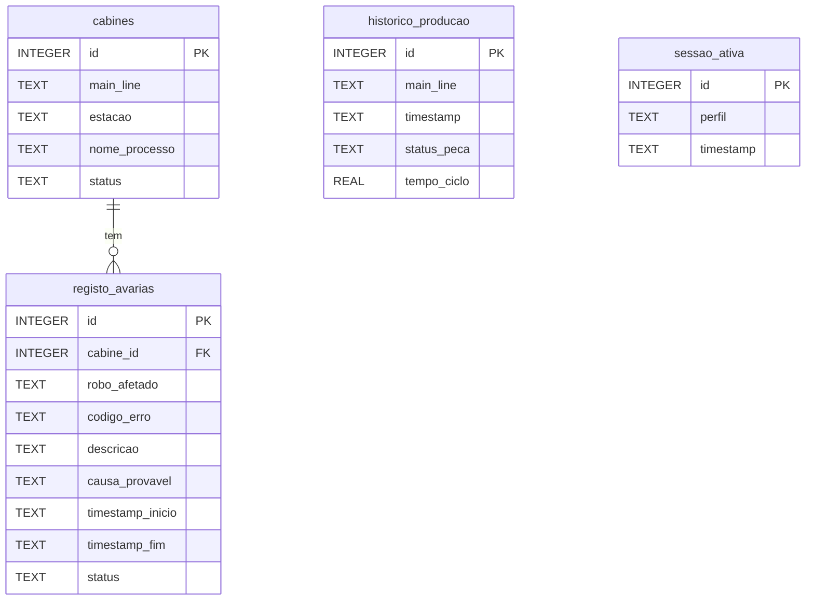

# Modelo de dados atual do BRUNUS MES

Referência para a defesa do projeto, revista em **02/11/2026**. Descreve o código atual e substitui, para esta versão, a descrição conceptual da entrega inicial. O PDF original de 23/10/2026 permanece inalterado.

A definição do esquema está em [criar_base_dados.sql](../sql/criar_base_dados.sql), com `user_version = 1`. A base é SQLite; a inicialização e a migração usam esse mesmo ficheiro.

## Entidades e relação existente

Cada avaria pertence a **uma cabine existente**; uma cabine pode ter zero ou várias avarias, incluindo várias ativas. A chave estrangeira real é `registo_avarias.cabine_id → cabines.id`, com `ON DELETE RESTRICT`. As ligações da aplicação ativam `PRAGMA foreign_keys = ON`.

`historico_producao` e `sessao_ativa` aparecem separadas porque não têm chaves estrangeiras. Não existe uma tabela `linhas` nesta versão.

## Significado e integridade dos registos

| Tabela | O que representa | Regras principais no esquema |
|---|---|---|
| `cabines` | Estação de uma linha e o seu estado local atual. | `id` é chave primária; `main_line`, `estacao` e `nome_processo` são textos obrigatórios não vazios; `status` aceita `OK` ou `ERRO`, com valor inicial `OK`. |
| `registo_avarias` | Ocorrência de avaria numa estação, com diagnóstico e intervalo de reparação. | `id` é chave primária com `AUTOINCREMENT`; `cabine_id` é obrigatório e referencia a estação. Os campos descritivos são obrigatórios e não vazios. `ATIVO` exige fim nulo; `RESOLVIDO` exige fim preenchido e não anterior ao início. |
| `historico_producao` | **Uma peça à saída final da linha**, com resultado e tempo de ciclo em segundos. | `id` é chave primária com `AUTOINCREMENT`; linha e data/hora são obrigatórias. `status_peca` aceita `OK` ou `REJEITADA`; `tempo_ciclo` é numérico, positivo e finito. |
| `sessao_ativa` | Estrutura histórica conservada no esquema. | `id` é chave primária; `perfil` aceita `operador`, `tecnico` ou `master`; data/hora obrigatória. Não é utilizada pelo login atual. |

Os índices sobre datas de produção, cabine/estado das avarias e intervalo de avaria apoiam consultas. São índices **não únicos**: não existe uma restrição de unicidade para `(main_line, estacao)`, para nomes de linhas ou para datas de eventos.

`REAL` usa vírgula flutuante binária e **não garante representação exata de valores decimais**. O tempo de ciclo é expresso em segundos; a validação assegura valor positivo e finito, sem o transformar num decimal exato. A formatação com casas decimais no ecrã/PDF é uma regra de apresentação. As estimativas financeiras fictícias não constituem um modelo contabilístico de precisão decimal.

### Produção por linha e avarias por estação

`main_line` agrupa logicamente as estações e identifica a linha nos registos de produção. É texto, sem chave estrangeira ou lista fechada de nomes. O simulador escolhe linhas existentes em `cabines`; o esquema SQL, por si só, não impede um registo de produção com outro nome de linha.

Uma peça não é registada novamente em cada cabine: não se devem somar passagens por estação para obter a produção final. As avarias obtêm a linha através da cabine referenciada. O relatório calcula a produção por linha e une intervalos de paragem sobrepostos da mesma linha; entre linhas, soma **segundos-linha**.

No simulador, uma avaria ativa suspende a produção de toda a linha. Resolver uma avaria e atualizar o estado da cabine é uma transação dos serviços: a cabine permanece em `ERRO` se existir outra avaria ativa. Esta coerência entre tabelas é mantida pelo código; não existe um trigger SQL que a imponha automaticamente a qualquer escrita externa.

### Autenticação atual

O dashboard verifica hashes de palavras-passe em `.streamlit/secrets.toml` e guarda o perfil autenticado em `st.session_state`. Não consulta nem escreve `sessao_ativa` para iniciar ou terminar sessão. Esta tabela não representa contas individuais nem um registo de auditoria implementado.

O lançador de demonstração usa uma pasta `.streamlit` própria em `data/demo/`, com acessos sintéticos. A configuração habitual da instalação é gerida separadamente.

### Administração sem alteração do esquema

Os serviços de `configuration.py` permitem ao master adicionar estações e editar o processo. Mudanças de linha/nome e remoção são recusadas quando a estação tem avarias ou a linha tem produção, preservando o significado do histórico. Duplicados são verificados pelo serviço; não foi acrescentada uma restrição `UNIQUE` ao esquema.

As cópias de segurança incluem as quatro tabelas e as sequências de numeração. O restauro valida o esquema e os dados e substitui o conteúdo numa transação, guardando antes o estado atual. Não inclui ficheiros de credenciais.

## Datas e turnos

As datas são textos ISO com hora civil local, sem fuso horário: `AAAA-MM-DD HH:MM:SS` ou com separador `T`, podendo incluir de um a seis algarismos de fração de segundo. Os `CHECK` validam a data, a hora e a ordem início/fim das avarias.

| Turno | Início na data selecionada | Fim exclusivo |
|---|---|---|
| 1 | 08h00 | 17h00 do mesmo dia |
| 2 | 17h00 | 01h00 do dia seguinte |
| 3 | 01h00 | 08h00 do mesmo dia |

A data selecionada é a **data civil de início do turno**. Os intervalos são `[início, fim)`: às 01h00 começa o turno 3; às 08h00, o turno 1; às 17h00, o turno 2. Entre as 00h00 e antes da 01h00, o turno atual é o **turno 2 do dia anterior**. Por exemplo, às 00h30 de 03/11/2026 corresponde o turno 2 de 02/11/2026.

Os turnos são calculados em [reporting.py](../brunus_mes/reporting.py); não existe uma tabela de turnos nem uma coluna de turno nos eventos. Na mudança de hora de verão/inverno, as horas sem fuso não permitem distinguir instantes repetidos nem garantir a duração física real.

## Evolução futura

Uma eventual entidade de linhas com identificador próprio e relações formais exigirá uma alteração explícita do esquema, migração dos dados e atualização dos testes. Contas individuais, auditoria, rastreio de peças por estação e aquisição real de PLC também são trabalho futuro. O indicador de qualidade atual é FTT; este modelo não fornece, por si só, OEE completo nem valida uma instalação industrial real.
